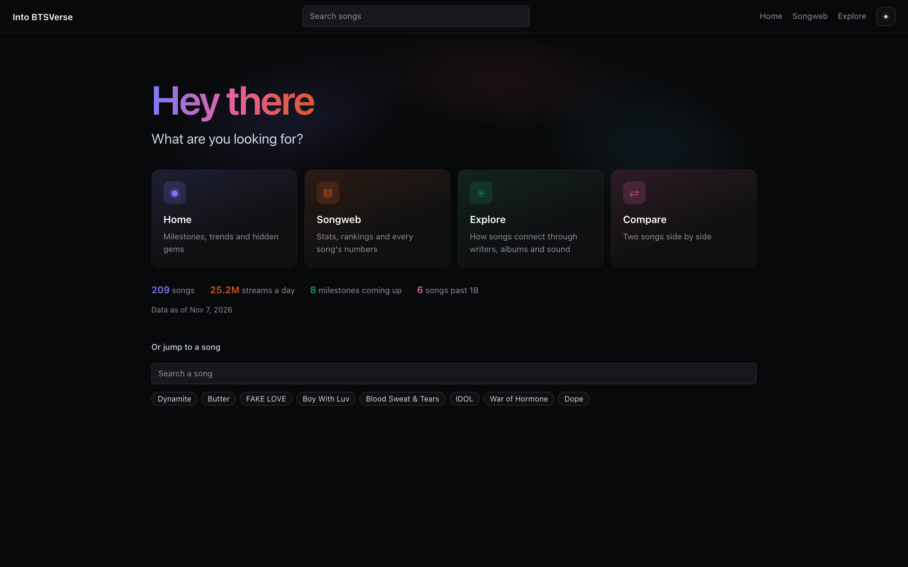
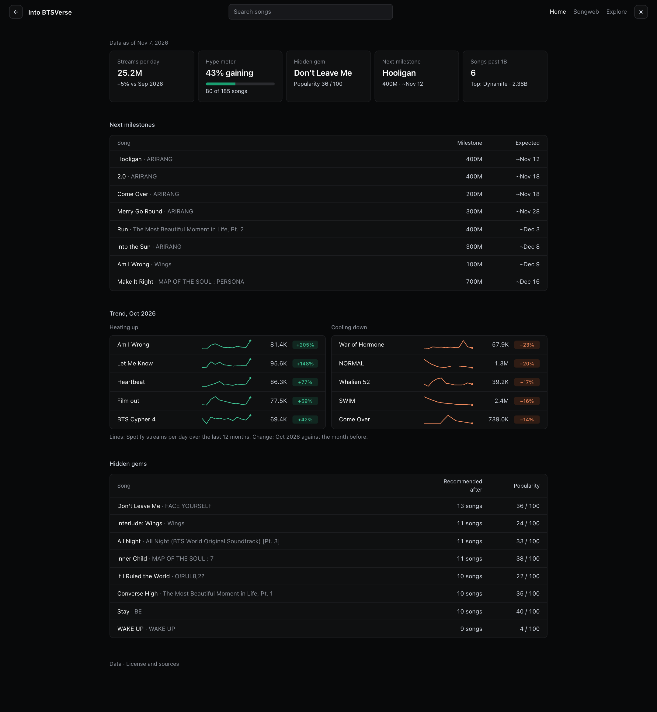
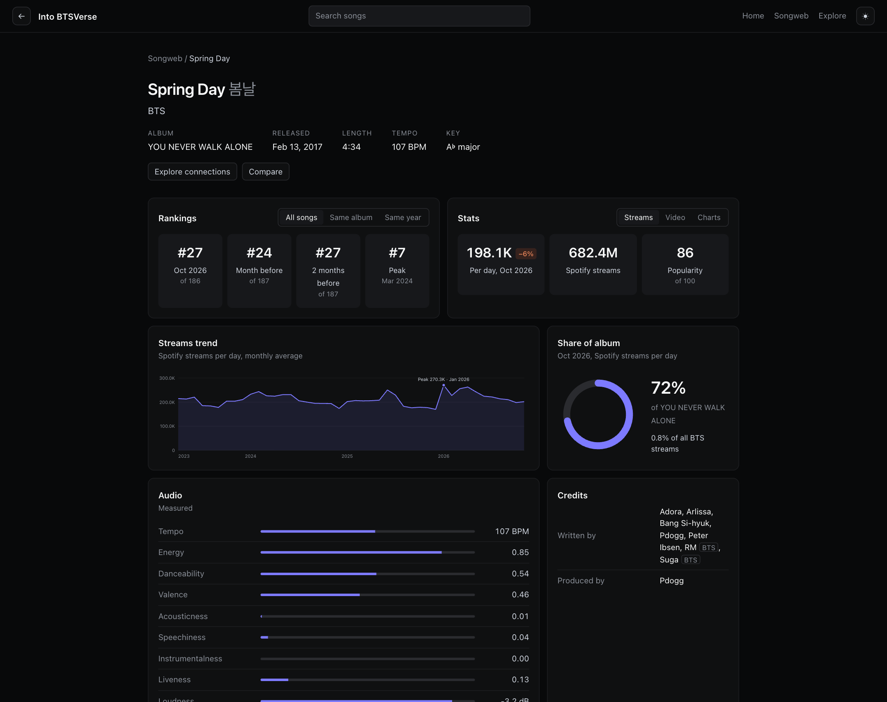
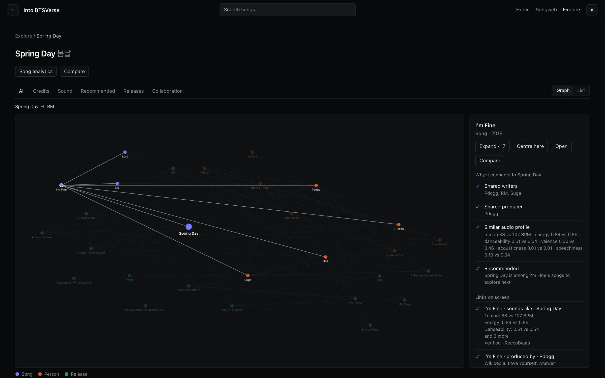
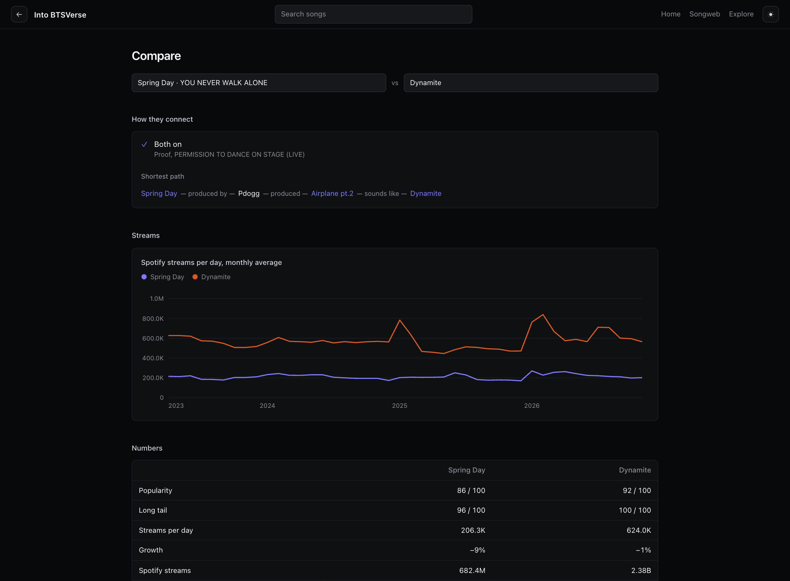
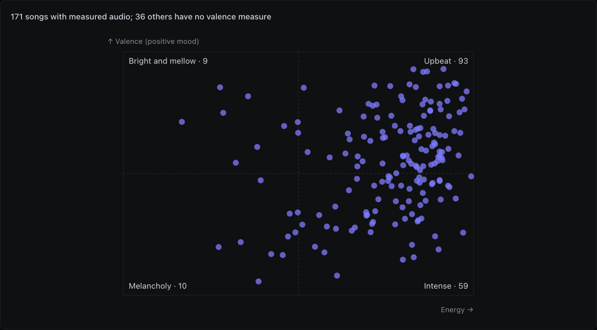
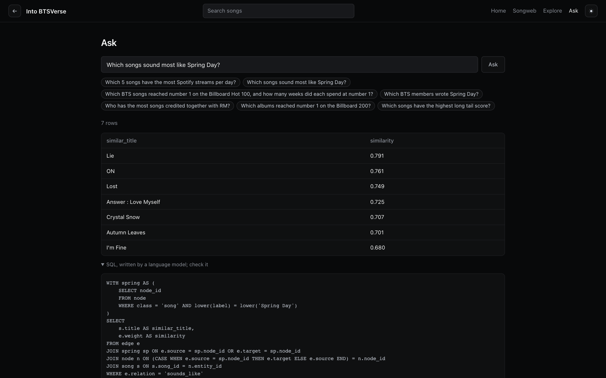
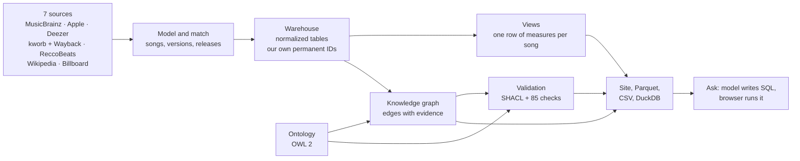

# Into BTSVerse

**[Open the site](https://abiramashree.github.io/Into-BTS-verse/)** · [Data dictionary](DICTIONARY.md) ·
[Ontology](https://abiramashree.github.io/Into-BTS-verse/ontology.html) · [Validation rules](https://abiramashree.github.io/Into-BTS-verse/shapes.html) · [License and sources](LICENSE.md)

The BTS catalog as one dataset you can trust and explore: 7 public sources joined into a normalized warehouse, a
knowledge graph that explains every connection it draws, and a site where anyone can see what's rising, why two songs
belong together, or ask a question in plain English.



## At a glance

| | |
|---|---|
| Catalog | 209 songs, 430 recordings, 1,021 tracks, 42 releases, 282 credited people |
| History | 42 Spotify snapshots since April 2023, 418 Billboard 200 weeks and 185 Hot 100 weeks |
| Knowledge graph | 2,528 nodes and 9,383 edges across 22 relations; every edge carries its evidence and source |
| Ontology | OWL 2: 31 classes, 37 relations, 58 attributes, 29 mappings to schema.org, Wikidata and the Music Ontology |
| Quality | 85 checks on every build, 95 automated tests including a browser test, reproducible exports |
| Privacy | All published IDs are this project's own; no Spotify, Apple, MusicBrainz, Deezer or YouTube IDs |

## Measured

| What | Result |
|---|---|
| Ask accuracy | 14 of 14 test questions answered correctly, each checked against a known answer, including every example question on the site (one run, 2026-11-11) |
| FAIR score of the ontology ([FOOPS!](https://foops.linkeddata.es)) | 80%: Interoperable 3/3, Reusable 265/267, Accessible 3/4, Findable 12/16, assessed on `ontology.ttl` on 2026-11-11. Not done yet: a persistent w3id.org address, a DOI and a listing in the LOV registry |

## What you can do

**See what's moving.** Home shows the songs about to cross a streaming milestone (with an expected date), what's
heating up and cooling down this month with each song's 12-month line, and hidden gems the recommendations keep
leading to.



**Understand any song.** Its monthly rank among all songs, its album or its year; streams, video and chart stats; its
share of its album's listening; measured audio features; writers and producers.



**Follow the connections.** Explore starts from a song and grows a path one click at a time (song → writer → their
other songs → their collaborators), ranked by how close each one is to where you started. Click any node or link to
see why it's there: shared writers, same album, similar audio profile, same era, a recommendation.



**Compare two songs** side by side: how they connect (including the shortest path between them), both stream lines,
the numbers, and how alike they sound against every other pair in the catalog.



**See the shape of the catalog.** Songweb ranks songs by any measure and maps every song with measured audio by
energy and mood, which shows where the catalog is dense and where it has gaps.



**Ask in plain English.** A question becomes one read-only SQL query, written by a language model and run in your
browser on the published files. The query is always shown, so every answer can be checked.



Light and dark themes, phone layouts, and keyboard-reachable lists for every chart and graph.

## How it works



- **Matching.** One song can exist as many recordings (live, remix, Japanese, remaster) and many tracks. Songs are
  merged by evidence with union-find, and every merge rule is checked on each build.
- **Measures.** Streams are spread evenly across each snapshot interval to get monthly and daily figures; relinked
  Spotify tracks are de-duplicated; drops are never counted as negative streams.
- **Reproducible.** The whole pipeline rebuilds offline from a local cache in about 15 seconds; the Parquet and CSV
  exports come out byte for byte the same.

## Why the ontology matters

The ontology (`ontology.ttl`) isn't documentation that sits beside the data. The build reads it, and it drives five
things:

1. **The graph's schema.** Every class, relation and attribute in the graph is generated from it, and every edge is
   checked against it. A relation the ontology doesn't define can't be published.
2. **Validation.** SHACL shapes are generated from it and run on every build (2,528 nodes, 28,945 triples). They
   caught tracks linked straight to a song where the model expects a recording; the ontology gained `track_of_song`
   for the 217 tracks with no matched recording.
3. **Definitions.** Every published column has a definition that comes from the ontology or the SQL that builds it,
   and the build fails if one is missing. That's where [DICTIONARY.md](DICTIONARY.md) comes from.
4. **The language model's knowledge.** Ask's instructions are generated from it: what each column means and its
   unit, which way each relation points, which relations are stored once for both directions, which are kinds of
   others (lyrics and music credits are writing credits), and what each edge weight measures. None of it is typed by
   hand, so it can't drift from the data.
5. **Interoperability.** Its terms map to schema.org, Wikidata and the Music Ontology, and the recommender's settings
   (hidden gem weight, variety, which paths count) live in the ontology, so tuning doesn't need code changes.

## Definitions

| Measure | What it means |
|---|---|
| Streams per day | Spotify streams gained per day, averaged over the last 90 days |
| Growth | Streams per day in the last 90 days against the 90 days before |
| Popularity | Percentile of streams per day among songs with data (0–100) |
| Long tail | Percentile of 2025 streams per day among songs released before 2023: staying power, not launch size |
| Monthly rank | Position by streams per day that month, among all songs, the same album or the same year |
| Hype meter | Share of songs with more streams per day last month than the month before |
| Next milestone | The next 100M step up to 1B, then every 500M; the date assumes last month's daily rate continues |
| Hidden gem | A song the recommendations lead to most often, among songs with popularity 40 or under |
| Sounds like | Closest songs by distance across six standardized audio features (tempo, energy, danceability, valence, acousticness, speechiness), verified audio only |
| Recommendations | Five per song, picked one at a time for relevance and variety (MMR): sound first, then same first release, with a small nudge toward less-streamed songs |
| Mood map | Energy against valence (musical positivity), split at 0.5 into upbeat, intense, bright and mellow, and melancholy |

Every column of every table is defined in [DICTIONARY.md](DICTIONARY.md).

## Trust, quality and responsible AI

- **Checks on every build (85).** Merges, de-duplication, totals that must add up, no negative stream gains, score
  ranges, a validated estimate for every estimated audio value, competency questions with known answers (for example,
  Spring Day's member writers are RM and Suga), and the graph against the ontology.
- **Tests (95),** including a browser test of every page in both themes and at phone width, run before every publish.
- **Estimates are labelled, or dropped.** Audio for 23 songs is estimated from previews and marked as estimated. An
  estimated danceability that tested no better than a baseline was removed instead of published.
- **No source IDs.** The build maps every source ID to this project's own and checks that none leaks into a published
  table; each publish scans the files again.
- **Ask, with guardrails.** The model only writes SQL; it never sees the data or runs anything. The query runs in the
  visitor's browser on public files and must pass the same read-only check in three places (the model service, the
  page and the Python tools). If a query fails, the model gets one chance to repair it. The API key stays on the
  server, use is limited (6 a minute, 20 a day per visitor), and the page's security policy blocks every other
  address.

## Built with

Python 3.12, DuckDB and SQL; rdflib and pySHACL; a static site with Cytoscape.js and DuckDB-WASM; a Cloudflare Worker
calling Groq (`gpt-oss-120b`) for Ask; Playwright for browser tests; GitHub Pages.

## Files

- `data/bts.duckdb`: every table and view in one file.
- `data/parquet/`, `data/csv/`: one file per table and view.
- `schema.sql`: table definitions, primary and foreign keys, allowed values (ENUMs).
- `views.sql`: the reporting views built on the tables.
- `ontology.ttl`: the ontology (OWL 2).
- `shapes.ttl`: the rules every build checks the graph against (SHACL).
- `graph/`: rebuilds the graph and recommendations from the tables and validates them.
- `graph.sql`: the knowledge graph built on the tables.
- `DICTIONARY.md`: every column of every table and view, and what it means.

```sh
duckdb data/bts.duckdb
```

## Tables

All keys are Into BTSVerse IDs: permanent integers per table (`song_id` 1, 2, ...), never reused or renumbered. `song`,
`album` and `person` also have a readable `slug` (`spring-day`, `arirang`).

| Table | Holds | Key | Links to |
|---|---|---|---|
| `album` | Albums, EPs and singles. | `album_id` |  |
| `album_series` | Series of releases. | `album_series_id` |  |
| `album_series_member` | Releases in each series, in order. | `album_series_id`, `position` | `album`, `album_series` |
| `song` | Songs. | `song_id` | `album` |
| `album_track` | Tracklists. | `album_id`, `disc`, `position` | `album`, `song` |
| `recording` | Recordings of each song, by version. | `recording_id` | `song` |
| `track` | Spotify and Deezer tracks. | `track_id` | `recording`, `song` |
| `video` | YouTube videos. | `video_id` | `song` |
| `track_snapshot` | Streaming metrics per track, by date. | `track_id`, `metric`, `observed_at` | `track` |
| `video_snapshot` | Video views, by date. | `video_id`, `observed_at` | `video` |
| `track_audio` | Audio features per track. | `track_id`, `feature` | `track` |
| `song_audio_estimate` | Audio features estimated from 30-second previews. | `song_id`, `feature` | `song` |
| `audio_validation` | Estimates compared with reference values. | `song_id`, `feature` | `song` |
| `song_audio_track` | Track that supplies each song's audio features. | `song_id` | `song`, `track` |
| `person` | Writers, composers, lyricists and producers. | `person_id` |  |
| `credit` | Song credits. | `song_id`, `person_id`, `role` | `person`, `song` |
| `hot100_entry` | Billboard Hot 100 weeks. | `week`, `rank` | `song` |
| `billboard200_entry` | Billboard 200 weeks. | `week`, `rank` | `album` |
| `song_link` | Links between titles of the same song. | `a`, `b`, `kind` | `song` |

## Views

| View | Holds |
|---|---|
| `song_audio` | Audio features per song: its audio profile, the verified analysis of the track on its album or else its preview estimate. key: pitch class, 0 = C, -1 = none. mode: 1 = major, 0 = minor. loudness: dB. |
| `song_spotify_streams` | Spotify streams per song per snapshot. Tracks of one song within 1% of each other count once. |
| `song_streams_daily` | Streams gained between snapshots, per song. NULL where the total decreases or exceeds three times the daily figure. |
| `album_streams_monthly` | Streams per album per calendar month. |
| `song_streams_monthly` | Monthly average daily streams per song. |
| `song_intelligence` | One row per song: catalog facts, latest totals and analytical signals. Rates compare the last 90 days with the 90 before. long_tail_score: percentile of 2025 streams per day among songs released before 2023, the measure of staying power. revival_score: largest monthly surge against the song's prior 6-month median (at least 5,000 streams per day), net of the same surge for songs a year or more old, for songs released a year or more before. has_revival: that month at least doubled. |
| `song_mv_views` | Music video views per song per snapshot. |
| `song_credit` | Credits per song and person, as writer or producer. |
| `album_summary` | One row per album, EP or single. Totals cover songs first released on it. |
| `person_summary` | One row per credited person. |
| `verified_analysis` | Audio features per track (Spotify's values, via ReccoBeats): one verified analysis each. |
| `estimated_analysis` | Audio features estimated from a song's preview: one estimated analysis each. |

## Graph

A knowledge graph of the catalog, rebuilt from the tables on every build. Its classes, relations and attributes are
defined in `ontology.ttl` (OWL 2), under `https://abiramashree.github.io/Into-BTS-verse/ontology#`, and every edge is
checked against them. Every build also validates the nodes, edges and attributes against `shapes.ttl` (SHACL):
datatypes and ranges, required values, allowed values and the classes each relation connects.

| Table | Holds |
|---|---|
| `graph_class` | The ontology's classes, generated from ontology.ttl. |
| `graph_relation` | Each class pair a relation allows, generated from ontology.ttl. |
| `graph_attribute` | The ontology's attributes, generated from ontology.ttl. |
| `graph_metapath` | The routes recommendations walk, generated from ontology.ttl. |
| `graph_setting` | Numbers that tune recommendations, generated from ontology.ttl. |
| `graph_term` | The sources and confidence levels claims refer to, generated from ontology.ttl. |
| `node` | ontology class (member, album, single). |
| `edge` | Edges. evidence: what supports the edge, as label-value pairs. |

```
agent          group (BTS) · person → member
creative_work  song (→ intro, outro, interlude, skit) → recording → track · video · release → album, EP, single
audio_analysis verified_analysis (one track) · estimated_analysis (one preview)
chart          Billboard Hot 100 · Billboard 200
```

| Relation | Connects | Meaning | Weight |
|---|---|---|---|
| `analyses_song` | estimated analysis → song | The song whose preview an estimated analysis measures. |  |
| `analyses_track` | verified analysis → track | The streaming track a verified analysis measures. |  |
| `audio_profile` | song → audio analysis | The analysis that stands for a song's sound: of the track on its own album, or else a preview estimate. |  |
| `by_artist` | release, song → group | The group a song or release is by. |  |
| `charted_on` | release, song → chart | A song charted on the Hot 100, or a release on the Billboard 200. | Weeks on chart |
| `collaborated_with` | person ↔ person | Two people credited together on at least one song. | Songs credited together |
| `credited` | song → person | Someone credited on a song, in any role. |  |
| `first_released_on` | song → release | The release a song first appeared on. |  |
| `in_series` | release → album series | The series a release belongs to. |  |
| `lyrics_by` | song → person | Credited as lyricist. |  |
| `member_of` | person → group | A person belongs to a group. |  |
| `music_by` | song → person | Credited as composer. |  |
| `on_album` | song → release | A song is on a release's tracklist, in any version. |  |
| `produced_by` | song → person | Credited as producer. |  |
| `recommends` | song → song | A song to listen to next after another. | 1 / rank |
| `recording_of` | recording → song | A recording is one version of a song. |  |
| `shares_writers` | song ↔ song | Two songs with credited people in common. | Cosine similarity |
| `sounds_like` | song ↔ song | Two songs with verified audio that are close on audio features. | 1 / (1 + d) |
| `sounds_like_estimated` | song ↔ song | A song with only estimated audio that is close to a song with verified audio on tempo and energy. | 1 / (1 + d) |
| `track_of` | track → recording | The recording a streaming track carries, where its ISRC identifies one. |  |
| `track_of_song` | track → song | The song a streaming track carries. |  |
| `video_of` | video → song | A video shows one song. |  |
| `written_by` | song → person | Credited as writer, lyricist or composer. |  |

Symmetric relations (↔) are stored once, with `source` < `target` compared as text (`song:10` before `song:9`).
`collaborated_with`, `shares_writers`, `sounds_like` and `recommends` are inferred from credits, audio features and
releases; each `recommends` edge lists one reason per meta-path. Skits are left out of recommendations. `by_artist` links
every song and release to BTS; leave it out of centrality measures. Streaming and chart measures are as of the latest
snapshot.

## Rebuild the graph

```sh
pip install -r requirements.txt
python -m graph data/bts.duckdb
```

Replaces the `graph_*`, `node` and `edge` tables in `data/bts.duckdb` from `ontology.ttl` and `graph.sql`, picks the
recommendations, and checks the result against `shapes.ttl`.

## Limits

- History starts December 2015 (Billboard 200), October 2017 (YouTube, Hot 100) and April 2023 (Spotify).
- Snapshots are roughly monthly.
- Audio features cover 194 songs: all features for 171; tempo and energy estimated from previews for 23.
- Credits cover songs with a Wikipedia track listing.
- Streams are Spotify only; YouTube views cover songs with a music video.
- Ask can misread a question; the query behind every answer is shown so it can be checked.

License: [LICENSE.md](LICENSE.md).
